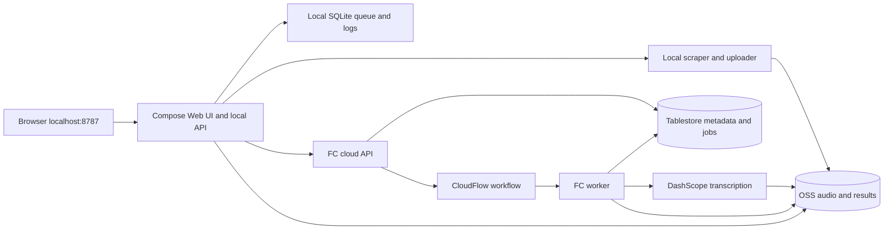

# Architecture

The supported product is a local Chinese control panel backed by Alibaba Cloud. Docker Compose runs the panel and its local scheduler. Alibaba Cloud runs the API and durable parsing workflows. Stopping Compose does not stop a workflow already submitted to the cloud.

## Data flow

1. **Import/resolve:** the local scraper resolves links and collection membership. Collections, resource titles, parts and associations are persisted through the cloud API. The UI renders this cloud catalog.
2. **Download/upload:** download locally, extract audio when needed, upload each part under `audio/`, register its identity and link it to the resource. Checkpoints let retries reuse successful uploads. Local audio is deleted after upload, registration and linking succeed; startup also sweeps uploaded caches. Failed stages may retain files.
3. **Parse:** the API reserves audio and creates a durable job. CloudFlow invokes the worker, waits 60 seconds when work remains, and invokes it again. The worker submits/polls DashScope using signed OSS source URLs, saves raw results and produces transcripts under `results/`.
4. **Export:** saved raw results can be exported again without repeating recognition. Batch downloads build a temporary local ZIP with collection/video/part paths and a manifest, then remove it after serving. A 512 MB source-byte limit bounds each batch.
5. **Cleanup:** explicit panel actions delete selected audio/results/outputs. Durable deletion intents and active-job reservations coordinate cleanup with parsing. Metadata records describe deleted artifacts. Versioned-bucket cleanup has additional safeguards: deleting a current object does not necessarily remove historical versions.

## Scheduling and recovery

Only local download/upload shares one sequential transfer lane. Metadata resolution, parse submission and export dispatch independently, with no application-wide cloud parsing cap. A completed upload can parse while later videos download. Combined pipelines release the transfer lane before submitting their parse stage.

The scheduler tracks child processes separately and prevents conflicting operations on the same resource. A data-directory lock permits one local scheduler per queue. SQLite stores progress; restart recovery requeues interrupted work and uses upload checkpoints. Preserve the named volume when rebuilding containers.

Cloud job records use conditional revisions and leases. Workflow invocations claim work before changing state; retries and cleanup respect reservations. Uncertain provider submissions are surfaced for attention instead of blindly starting another paid transcription. Local cancellation and cloud job lifecycle are separate; submitted cloud work remains durable.

No application cap does not mean infinite capacity: Alibaba quotas, DashScope rate limits and local resources still apply. FC allows one invocation per instance and scales instances independently. Catalog scans and local subprocess dispatch suit a personal library; much larger installations would need indexed queries and resource-aware dispatch.

## Storage and credentials

| Location | Contents |
| --- | --- |
| `cloud/.env.local` | Authoritative developer config/credentials; Git-ignored |
| `cloud/.panel.env` | Generated API URL/token and OSS credentials for Compose |
| Docker volume `/data` | SQLite queue, logs, settings, temporary/retry files |
| OSS `audio/` | Source audio, retained until explicit cleanup |
| OSS `results/` | Raw provider results and formatted transcripts |
| OSS `code/` | Immutable deployment ZIPs addressed by SHA-256 |
| Tablestore `transcript_records` | Collections, resources, audio, jobs and shared settings |
| SLS `functions` | Function logs with seven-day retention |

The browser talks to the local panel. Its backend calls the cloud API using a bearer token and obtains signed artifact links. The cloud API serves no website and rejects requests carrying a browser Origin header. Compose exposes only loopback; local origin checks are intended for personal local use, not public hosting or multi-user authentication.

Deployment and local uploading use explicit env-file credentials with no CLI/profile fallback. FC supplies execution-role credentials to cloud functions. Only the worker receives the DashScope key. Generated RAM roles scope OSS access by prefix; the API additionally receives cleanup/workflow-start permissions. The deployment identity has broader infrastructure duties. `cloud/infra/uploader-policy.example.json` illustrates upload-only OSS permissions for a separately provisioned identity; the default centralized setup uses the configured deploy identity locally.

## Deployment lifecycle

`cloudctl.py` bootstraps the locked Python environment and invokes `cloud/manage.py`. `ops/config.py` validates the env file and writes derived panel config. `infra/app.py` produces native ROS JSON with Python alone; no CDK, Node process or hosted-domain stack is involved.

The builder exports locked dependencies for Linux x86-64/Python 3.12, copies the application, rejects Windows binaries, and creates a deterministic ZIP plus source fingerprint. FC supplies `oss2`/`crcmod`; other runtime dependencies are packaged. `up --no-build` verifies both the ZIP checksum and current source/dependency fingerprint.

The manager discovers stacks by exact prefix/region, checks storage identity and waits for ROS terminal states. Rollback/failure is not treated as success:

- **`<prefix>-storage`:** bucket (unless externally owned), Tablestore instance and table. Resources use retain policies. A healthy existing storage stack is reused without changing ownership/settings.
- **`<prefix>-app`:** API/worker functions, HTTP trigger, CloudFlow workflow, roles, SLS project/logstore. Redeploy updates this stack in place.

`down`/`destroy` remove only the app stack. Storage and its costs remain; `up` recreates compute and refreshes the API URL. Permanent erasure is an explicit storage operation. Deployment packages also remain under `code/`; any future retention policy must preserve rollback packages. Run one lifecycle operation at a time and let active cloud jobs finish before taking compute down.

## Source map and verification

| Path | Responsibility |
| --- | --- |
| `cloudctl.py`, `cloud/manage.py`, `cloud/ops/` | Configuration and lifecycle commands |
| `cloud/infra/app.py`, `cloud/scripts/build.py` | ROS templates and Linux packaging |
| `cloud/src/transcript_cloud/local*.py` | Local server/client, queue, scheduler and stages |
| `cloud/src/transcript_cloud/studio_static/` | Chinese browser UI |
| `cloud/src/transcript_cloud/ingest.py`, `audio-scraper/` | Resolution, download and upload |
| `cloud/src/transcript_cloud/api.py`, `handlers.py` | Cloud routes and FC entry points |
| `cloud/src/transcript_cloud/service.py`, `provider.py` | Durable transitions and DashScope |
| `cloud/src/transcript_cloud/catalog.py`, `storage.py` | Catalog and conditional storage |
| `cloud/src/transcript_cloud/cleanup.py` | Coordinated OSS deletion |
| `cloud/src/transcript_cloud/exporter.py`, `bundles.py` | Transcript formats and ZIP downloads |
| `cloud/tests/`, `audio-scraper/tests/` | Regression and mocked lifecycle tests |

`python cloudctl.py test` runs Python suites and lint. `check` performs read-only live auth/catalog checks without paid model work. Destruction tests use fake ROS clients, never live data. The legacy Whisper application, alternate hosted UI/domain config and manual stack-ID scripts are removed from this branch.
